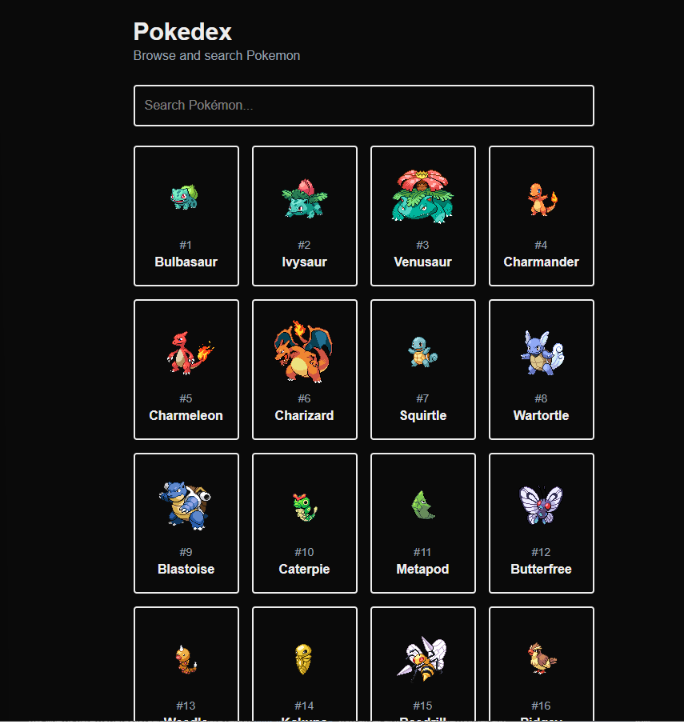

# Pokédex



A responsive Pokémon browser built with Next.js, TypeScript and Tailwind CSS, using the public [PokéAPI](https://pokeapi.co/).

**Live demo:** https://pokedex-mauve-gamma-83.vercel.app/

## Features

- Responsive grid of the first 151 Pokémon (2, 3 or 4 columns depending on screen width)
- Instant client-side search by name
- Detail page for each Pokémon with artwork, types, height and weight
- Dynamic routes (`/pokemon/[name]`) with a 404 page for unknown names
- Optimized images using `next/image`

## Tech Stack

- Next.js (App Router, Server Components)
- TypeScript
- Tailwind CSS
- PokéAPI
- Deployed on Vercel

## Getting Started

You need Node.js 20.9 or higher.

```bash
git clone https://github.com/DevilGod129/pokedex.git
cd pokedex
npm install
npm run dev
```

Open [http://localhost:3000](http://localhost:3000) in your browser.

## Project Structure

- `src/app/page.tsx`: home page, fetches the Pokémon list on the server
- `src/app/pokemon/[name]/page.tsx`: detail page for a single Pokémon
- `src/components/PokemonGrid.tsx`: client component with search and the responsive grid
- `src/components/PokemonCard.tsx`: reusable card linking to the detail page

## Credits

Data and sprites are provided by [PokéAPI](https://pokeapi.co/). Pokémon and Pokémon character names are trademarks of Nintendo. This is a learning project and is not affiliated with Nintendo or The Pokémon Company.
